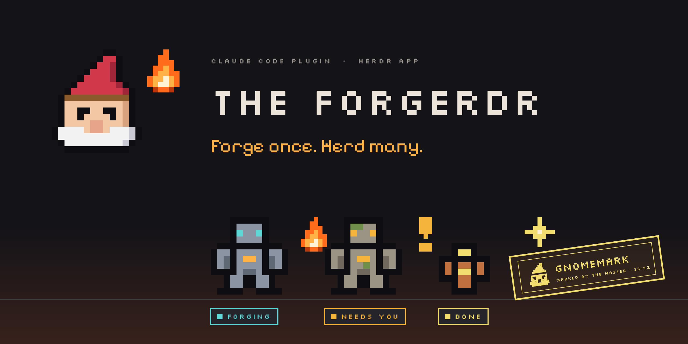

<p align="center">
  <a href="https://github.com/Gn0m0-dei/the-forgerdr">
    
  </a>
</p>

<h1 align="center">the forgerdr</h1>

<p align="center">
  <strong>Forge once. Herd many.</strong>
</p>

<p align="center">
  <a href="./LICENSE"></a>
  <a href="#install"></a>
  <a href="#the-herdr-app"></a>
  <a href="./CHANGELOG.md"></a>
</p>

A Claude Code plugin for the [herdr](https://herdr.dev) desktop app that carries a whole way of working: coding standards, a terse communication mode, a lazy build philosophy, a persistent-memory protocol, a spec → plan → build flow, an interactive pull request reviewer, a backlog item workflow, and the two things that make a window full of agents worth it: fan out N pull requests into N tabs, fan out N items (backlog items, OpenSpec changes or plain tasks) into N worktrees, each opened as its own space with its env files, its dev server and its own agent.

| Layer | Pieces | What it gives |
|---|---|---|
| Rules, every session | standards · communication · build · memory | one way of coding, talking, building and remembering |
| Design to delivery | `spec` → `plan` → `build` → `ship` | design gate, TDD plan, verified execution, pull request |
| In this session | `review-other` · `review-own` · `debug` · `security` · `research` | interactive and gated, with fresh-context agents where a second pair of eyes helps |
| A session per item, on the herdr app | `workitem` · `worktree` · `review` | one item or many (separated by `\|`; pull requests by spaces); a titled session each, several grouped in new tabs as many panes to a tab as fit, worktrees and dev servers when asked |

> **The herdr app, not the herdr TUI.** From 0.15.0 forgerdr drives the herdr desktop app (`herdr-app`) and herdr-core (`hc`), which runs its terminals and agents. The app and the TUI run separate servers and share no agents, workspaces or plugins, so forgerdr supports one of them: the TUI version is 0.14.x and lives on the [`tui`](https://github.com/Gn0m0-dei/the-forgerdr/tree/tui) branch (see [Install](#install)).

## Install

Fresh machine, macOS or openSUSE Tumbleweed:

```bash
curl -fsSL https://raw.githubusercontent.com/Gn0m0-dei/the-forgerdr/main/install.sh | bash
```

That puts the tools on the machine, each step skipped when the tool is already there: git, jq, node, pnpm, `az` with the azure-devops extension, `gh`, `glab`, the [engram](https://github.com/Gentleman-Programming/engram) binary, the [herdr app](https://herdr.dev/download/) with herdr-core, Claude Code, the [codebase-memory-mcp](https://github.com/DeusData/codebase-memory-mcp) binary and the [OpenSpec](https://github.com/Fission-AI/OpenSpec) CLI. Another distro: install those by hand.

Then open the herdr app, start Claude Code in one of its terminals, and run:

```
/plugin marketplace add Gn0m0-dei/the-forgerdr
/plugin install forgerdr@the-forgerdr
/forgerdr:setup
```

`/forgerdr:setup` completes the rest and reports a table: engram server, the MCP servers reaching through the plugin, the herdr app and its optional keys, provider sign-ins (yours to run), Claude Code settings, and the leftovers the plugin now replaces, the herdr TUI's forgerdr plugin among them.

Local checkout instead of the marketplace: `claude --plugin-dir /path/to/the-forgerdr`.

Still on the herdr TUI: install forgerdr 0.14.x from the `tui` branch instead, `/plugin marketplace add Gn0m0-dei/the-forgerdr#tui` and then `/plugin install forgerdr@the-forgerdr`. Both branches name the marketplace `the-forgerdr`, so remove the other one first (`/plugin marketplace remove the-forgerdr`); the README on that branch covers its herdr TUI plugin and keys.

### Memory and MCP servers travel with the plugin

`mcp-servers.json` declares the four MCP servers the way of working depends on, so nothing is registered by hand: **engram** (through `bin/engram-mcp.sh`, which scopes the server to the memory project key), **codebase-memory** (the code graph), **context7** (official library docs; export `CONTEXT7_API_KEY` for a higher rate limit) and **chrome-devtools** (browser verification). The engram and codebase-memory binaries are the only pieces outside the plugin; `install.sh` brings them like any other CLI.

Memory lives in `~/.engram/engram.db` and in Claude Code's own memory directory. A new machine starts empty unless you copy both.

## What runs on every session

`hooks/session-start.sh` injects the four rule files, resolves the **memory project key** (the workspace root when the repository sits in a workspace, a parent with its own `.claude`, `CLAUDE.md` or `AGENTS.md`; the repository otherwise), starts the engram server if it is down, folds the per-directory projects engram used to create into that key, registers the session, and after a compaction brings the project's memory context back. The engram MCP server is started with that same key, so a workspace of four repositories is one memory, not four.

Two layouts work without configuration. One repository with its own `.claude/skills` and `CLAUDE.md`: Claude Code loads them. A workspace of several repositories with shared `.claude/skills` and `CLAUDE.md` at the workspace root, above the git tree where Claude Code does not look: the session start lists those skills with their paths and prints that `CLAUDE.md`, so the agent reads them when they apply, from the main checkout and from any worktree of it. The other way round, a session started at the workspace root gets the skills inside each repository listed by repository.

Sessions carry the number they were opened for. `review` and `worktree` start every agent with `FORGE_SESSION_TITLE` in its environment (`PR <id>: <title>`, `#<id> <title>`, the change name for an OpenSpec change without a work item, the branch slug for free text) and the session start hook sets it as the session title, the same as `/rename`: `claude --resume` lists it, the herdr app shows it on the terminal, and memory saved in that session mentions the number. `workitem` opens one titled tab per item (`bin/forge-session.sh`) unless the session is already titled for the single item given; outside the app, a session that gains a number is asked once to `/rename` itself.

`hooks/guard-bash.sh` refuses, before they run, the commands the standards forbid: a branch created tracking the shared base, `git reset --hard` or `--mixed`, a force push, `pkill -f` and `killall`, `git worktree remove` inside the herdr app (it would leave the worktree's space open on a folder that is gone; `bin/forge-worktree-remove.sh` closes the space first), and a commit or pull request that attributes the work to AI (a whole-line trailer or badge is stripped instead and the command runs clean). `hooks/scrub-unicode.sh` removes invisible Unicode (zero-width, bidi controls, tag characters, stray BOMs) from every file the agent writes and reports the exotic spaces it leaves alone. `hooks/graph-augment.sh` adds code-graph context to every Grep and Glob. `hooks/engram-session.sh` closes the engram session on stop and captures subagent output. `hooks/worktree.sh` takes over Claude Code's own worktrees (`EnterWorktree`, subagents with `isolation: "worktree"`, `claude --worktree`): each one is a git worktree under `.claude/worktrees/<name>` on branch `worktree-<name>`, nested ones included, from the base `worktree.baseRef` asks for, with the ignored `.env*` files and the `.worktreeinclude` files copied; inside the herdr app it also opens as a space of its own that does not take the focus, which the app nests under its repository. When the session ends, the ones it created with no change, no commit and no agent at work in them are removed, their spaces closed and their branches deleted; the rest stay. Inside the app, when a session starts or ends, the spaces forgerdr opened for worktrees removed where no hook sees it (`git worktree remove` or `rm` from Bash or a terminal) are closed, unless an agent is still at work there or the session stands in one. Nothing it does throws work away: a worktree with uncommitted changes is never removed, not even when Claude Code asks, and a branch goes only while it still points where it started or is merged. Claude Code runs a plugin's `WorktreeCreate` hook for `claude --worktree` from 2.1.300 on, and never with `--worktree --tmux`; it reads `worktree.baseRef` from the settings files, not from managed settings or `--settings`. Background sessions, workflows and `remote-control` worktrees go through the hook too; only the subagent case has been run for real.

| Rule file | What it fixes |
|---|---|
| `rules/standards.md` | English in the repo, the user's language in chat and in comments, zero AI attribution, typing, style, error handling, git and pull request conventions |
| `rules/communication.md` | Terse replies, verdict first, full prose only where clarity needs it (warnings, drafts, review findings) |
| `rules/build.md` | The lazy ladder: nothing → reuse → stdlib → platform → installed dependency → one line → minimal code |
| `rules/memory.md` | When to search, when to save, what to save, how to close a session |

## Skills

| Skill | What it does |
|---|---|
| `/forgerdr:setup` | Installs and verifies the environment. Idempotent. |
| `/forgerdr:help` | Prints the cheat sheet: commands, flows, settings, the herdr app keys. Answered by a hook, without spending tokens. |
| `/forgerdr:mode` | Shows or sets the spec mode, globally or per project. |
| `/forgerdr:spec` | Classifies the request (spike, bounded, architectural), asks what matters, presents the design and stops for approval. The spec mode decides where the design is kept. |
| `/forgerdr:plan` | Turns an approved design into bite-sized TDD tasks with exact files, interfaces and tests, kept where the spec mode says. |
| `/forgerdr:build` | Executes a plan in this session: red, green, refactor, ledger, verification before every claim, fresh-context review at the end. |
| `/forgerdr:ship` | Finishes a branch: fresh verification, rebase, reviewer agent, commit with permission, `push -u`, pull request with the work item linked. |
| `/forgerdr:debug` | Root cause before any fix: investigate, pattern, one hypothesis at a time, regression test proven red then green. |
| `/forgerdr:security` | Runs the security auditor on the diff or a module, has a fresh verifier challenge every critical or high finding, triages confirmed and needs-validation findings with you, fixes only what you pick. |
| `/forgerdr:research` | Cited research report: sub-questions, one researcher agent each in parallel, synthesis with confidence levels. |
| `/forgerdr:workitem [--auto] <item> [\| <item>...]` | Works items in the current clone, one titled herdr app session per item, separated by `\|` (several in new `Work items` tabs, as many panes to a tab as fit): a backlog item URL (bug, PBI, task, issue), an OpenSpec change or free text, as the spec mode says. Brief, reproduce in the browser, root cause, proposal, branch without tracking, pull request, client-facing comment; an OpenSpec change continues from its stage. Six gates, none skipped. |
| `/forgerdr:worktree [--auto] <item> [\| <item>...]` | The same, each item in its own git worktree, opened as a herdr app space in the background: its branch (named by the spec mode, reused when it exists) from `origin/develop` (or the remote HEAD), the main clone's ignored `.env*` files and an uncommitted OpenSpec change copied over, a titled Claude agent running `workitem` in its first tab, the dev server on its own `PORT` in a second one. |
| `/forgerdr:review <url...>` | One titled Claude agent per pull request, one or many, in new herdr app tabs named `Reviews`, as many panes to a tab as fit (each at least 80×15), never in the tab you launch it from; a colleague's pull request runs `review-other`, your own runs `review-own`. |
| `/forgerdr:review-other <url>` | Reviews a colleague's pull request in this session: every finding explained, you pick, drafts in your language, nothing published without an explicit yes. |
| `/forgerdr:review-own <url>` | Handles the review comments on your own pull request in this session: fix, reply or question per thread, you pick, then pushes, replies and resolves. |

Providers are reached through their CLIs, never through MCP servers: `references/providers.md` holds the exact commands for Azure DevOps, GitHub and GitLab.

### Flow

`workitem` and `worktree` work in the manual flow unless `--auto` is passed.

| Flow | What happens after the brief |
|---|---|
| manual (default) | analysis, reproduction, root cause or proposal; the next command is suggested and you drive with `spec`, `research`, `plan`, `build`, `debug`, `security`, `ship` |
| `--auto` | the whole pipeline: a bug goes root cause → fix → security → ship; a backlog item goes spec (the item is the spec) → research when there are alternatives → plan → build → security → ship; an OpenSpec change goes from its stage (spec, plan, build or ship) to the end |

The gates hold in both: design approved before code, permission per commit, drafts before anything is published.

### Spec mode

The commands are always the same; a setting decides where the design and the tasks live. `/forgerdr:mode spec <value>` sets it globally, `--project` for the current workspace only; the value is printed at every session start. Stored in `~/.config/forgerdr/config.toml`.

| Value | Design and tasks live in | Backend |
|---|---|---|
| `chat` (default) | the conversation | nothing written; approval in chat |
| `openspec` / `openspec:<store>` | the repository's `openspec/`, or a registered OpenSpec store (a separate specs repository) | OpenSpec 1.x through its CLI: `new change`, artifacts from its own templates, `validate --strict`, `archive` on the branch before the pull request |
| `azure` | Azure Boards: a Feature, backlog items with Gherkin acceptance criteria, child tasks, progress comments | the [azdospec](https://github.com/Gn0m0-dei/azdospec) plugin when installed (forgerdr wraps `/azdo:propose`, `/azdo:apply`, `/azdo:archive`), forgerdr's own `az` commands otherwise |

The mode also decides what `workitem` and `worktree` take as an item (an OpenSpec change or a work item URL in `openspec`, a work item URL in `azure`, a URL or free text in `chat`) and how its branch is named: [`references/items.md`](references/items.md) and the standards' "Branch names". Several items are separated by `|`, and only by `|`.

In `azure`, branches follow azdospec's naming so `/azdo:apply` works on the branch forgerdr created instead of opening its own. In `openspec`, a work item's change is named `<id>-<slug>` and links the item; a bug that only restores specified behaviour creates no change.

The backlog may live in another Azure DevOps organization than the code, as when a client hosts the repository and another company runs the backlog. Nothing links across organizations, and a `#<id>` in a commit would link the item with that id in the client's organization, so such an item is named `EXT-<id>` in everything that stays in the repository: the branch (`feature/EXT-1234-login-button`), the commit footer (`Refs: EXT-1234`) and the pull request title, never with a link or a backlog URL. Where the backlog is lives in the clone's `.git/config` (`azdospec.organization`, `azdospec.project`), shared with azdospec and never committed: [`references/items.md`](references/items.md).

The gates do not move with the mode: no implementation before an approved design, no commit without permission, nothing published without a yes.

## Agents

Four subagents the skills dispatch for a fresh context, each limited to the tools its definition lists (inside the herdr app each one runs in a terminal of its own, see below):

| Agent | Dispatched by | Returns |
|---|---|---|
| `forgerdr:reviewer` | `build` (end of plan, or each task in agent mode), `ship` | findings graded critical / important / minor with file and line, verdict |
| `forgerdr:security-auditor` | `security`, `ship` | findings traced from actor to effect: confirmed with severity, needs-validation, rejected; smallest fix and regression test; domain references under `references/security/` |
| `forgerdr:security-verifier` | `security`, per critical or high finding | an independent attempt to refute the finding: confirmed, downgraded or rejected |
| `forgerdr:researcher` | `research`, one per sub-question | cited answer with confidence |

Inside the herdr app no agent runs hidden inside the session. `hooks/agent-dispatch.sh` intercepts every Agent call and starts the agent as its own Claude session in a herdr-core terminal of its own, through your login shell so it gets your environment (a login `sh` with the session's `PATH` for a shell that is neither of the sh family nor fish, such as nushell), without taking the focus: in a new pane next to the session, as the herdr TUI laid agents out. The first agent halves the session's pane, each next one the largest agent pane that keeps both halves at least 80×15, so they form an even grid, and once none can be halved the agent opens a tab of agents (`agents · <session>`) in the background, which the next ones fill the same way. With `isolation: "worktree"` it is a pane of its worktree's space. A session with no pane of its own (a sub-agent) starts its agents as sub-agents, which the app lists under it in its Agents sidebar. It gets the agent's definition (its instructions, its model, no write tools when the agent has none) and accepts the folder trust prompt for it, and it sends its final report back with SendMessage, beginning with `Report from <agent>`. The app shows whether it is working, waiting for you or done, from what Claude Code reports; `hooks/agent-state.sh` keeps the agent's record and reminds an agent that ends a turn without reporting, and the turn that reports ends with `✅ DONE`. End a done agent whenever you like, or keep it to ask it something. The next pass of the same task (a fix pass, a second review of a reviewer's own findings) goes to the same agent: the session sends it with SendMessage to the agent's name, and `hooks/agent-message.sh` delivers it as a new task, or, when its terminal ended, reopens the agent under the same name resuming its Claude session (`claude --resume`) with everything it already read. Nested agents work the same way, under the agent that started them. Each one is a whole session, so it costs more than an in-process subagent. A fork, and every agent outside the app, runs in-process. When the session ends, the agents it started that are done are ended. Tasks of one plan still run sequentially: one branch, one worktree, one editor at a time.

## The herdr app

forgerdr talks to the herdr app through its two command-line tools: `herdr-app do` for the window (spaces, tabs, the focus) and `hc` for the terminals and agents in it. The fan-outs and the agent dispatch work only inside a terminal of the app (`HC_TERMINAL_ID` set); outside it, the worktree hook and `forge-worktree-remove.sh` still make and remove plain git worktrees, and nothing else touches the app. New tabs and spaces open without taking the focus unless the command is about what you look at next (the first review tab, a `workitem` tab).

The scripts are plain bash over `herdr-app`, `hc` and `jq`:

```bash
bin/forge-worktree.sh  [--repo PATH]... [--base BRANCH] [--dev COMMAND] [--port-base N] [--auto] [--no-agent] [--branch NAME --title TEXT] <item>...
bin/forge-review.sh    [--cwd PATH] [--no-agent] <pr-url>...
bin/forge-session.sh   [--cwd PATH] [--no-agent] [--no-focus] --title TITLE <prompt>
bin/forge-session.sh   [--cwd PATH] [--no-agent] --group NAME --title TITLE <prompt> [--title TITLE <prompt>...]
bin/forge-worktree-remove.sh [--force] <path>
bin/forge-setup-keys.sh [--review KEY] [--worktree KEY] [--remove]
```

`forge-worktree.sh` makes each worktree where the app keeps its own (`worktrees.directory` in the app's `settings.json`, `~/.herdr/worktrees` by default), so the app's Open and Remove worktree see them, and `forge-worktree-remove.sh` removes one the way the app does: its space closed first, its branch kept. What the scripts cannot guess (which repositories an item touches in a multi-repo workspace, which `dev:<app>` script of a monorepo) the Claude skills decide and pass as flags: the repositories, the dev command, and the branch and title of every item the script cannot name from a work item (any item in `chat`, a change in `openspec`). They print one JSON line per worktree, tab or pull request.

`FORGE_CLAUDE_ARGS`, when set, adds its words to every `claude` the scripts and hooks start (for example `--plugin-dir <checkout>` or `--settings <file>` to try a change of the plugin before installing it).

### Keys

`bin/forge-setup-keys.sh` adds two keys to the app's `keys.json` (`/forgerdr:setup` offers it), so the fan-outs also work without a Claude session open:

| Key (macOS; Ctrl+Alt on Linux) | What it does |
|---|---|
| `Cmd+Alt+P` | Opens a tab that asks for pull request URLs and runs `bin/forge-review.sh` |
| `Cmd+Alt+T` | Opens a tab that asks for items separated by `\|` and starts a Claude session running `/forgerdr:worktree` on them, which reads the spec mode |

It keeps every other key, refuses a key you already use (`--review` and `--worktree` pick others), finds the installed plugin when the key runs so an update keeps it working, and `--remove` takes its keys away. Once `keys.json` is edited, the app treats it as yours and stops adding its new default keys to it.

### The forgerdr layout

forgerdr brings its own look for the app, drawn from the forgnome design: the `forgerdr` layout, the `forge-night` theme and the `forgerdr` mod, under `herdr/`. `bin/forge-herdr-install.sh` (`/forgerdr:setup` offers it) copies them into the app's home; `ctrl-shift-l` switches to the layout, and `ctrl-alt-shift-escape` always goes back to the app's own `main` layout. Across its top runs the forgerdr bar: a forge tab per space, with its gnome (its hat colour from the space's folder) and a badge of what its golems do (`!` when one waits on you, how many work, `✓` when one is done), the `+` that opens a space, the inbox of agents waiting on you (a click goes to the first) and the command palette with its key from `keys.json`. A forge tab does what the app's space list does: a click shows the space, a double click renames it, a right click opens the app's own space menu (rename, worktrees, close), its ✕ or a middle click closes it, and dragging it onto another reorders the spaces. When the tabs do not fit, the strip scrolls under the trackpad, and arrows on its sides bring in the next hidden tab. Under it, for now, the layout is the app's own window in the forgerdr look: Pixelify Sans for the panels, Maple Mono NF for the terminals (the app's JetBrains Mono when it is not installed), the forge-night colours. The mods that redraw it piece by piece come next, each one in a role of the `forgerdr` mod: a herdr app mod cannot read another mod's files, so they share one folder.

```bash
bin/forge-herdr-install.sh [--dev [--watch]] [--remove] [--force] [--switch]
```

Run again, it updates what it installed and leaves what you changed, naming it (`--force` replaces it, keeping a copy beside it); `--remove` takes it away, except the theme, which any layout may use. `--dev` installs the checkout beside it as `forgerdr-dev`, a copy of the mod and a layout that uses it, and `--watch` keeps that copy in step with the checkout until Ctrl-C, so the app reloads the mod as you edit it: the app does not see edits through a link.

The mod draws with a kit of the design's pieces (`herdr/mods/forgerdr/kit/`: chips, key buttons, tabs, tree rows, pane headers, meters, the empty state, the toast) and the design's pixel art: 12×12 icons in one ink, gnome heads in parts (hat, face by eyes and mood, beard, accessory) and golems, as SVG layers under `img/`. `node herdr/tools/sprites.mts` generates them from the design's exports in `herdr/tools/design/`; a layer of fixed colours is drawn with `image()`, and one colour that changes (a hat, a theme tone) with `svg()`, which the app tints, so the art follows the theme. `test/herdr-sprites.test.sh` fails when `img/` drifts from the generator. The `gallery` role shows every piece and sprite on one page, to compare with the design: `herdr-app do tab.new --name gallery --mod forgerdr-dev --props '{"role":"gallery"}'`.

## Development

```bash
pnpm install
pnpm lint       # biome + shellcheck (install.sh, bin, hooks, test, herdr/tools)
pnpm test       # the pure functions, the hooks, and the scripts against fake hc and herdr-app (test/fakes.sh)
pnpm validate   # claude plugin validate .
pnpm typecheck:herdr  # the forgerdr mod against the type files the herdr app writes (skipped where it is not installed; runs on commit when herdr/mods changes)
```

The fan-out scripts and the agent dispatch are also exercised by hand inside the herdr app (`--no-agent` creates the topology without starting agents; `FORGE_CLAUDE_ARGS="--plugin-dir $PWD"` makes the agents load the checkout). Say in the pull request what you ran.

## License

MIT.
